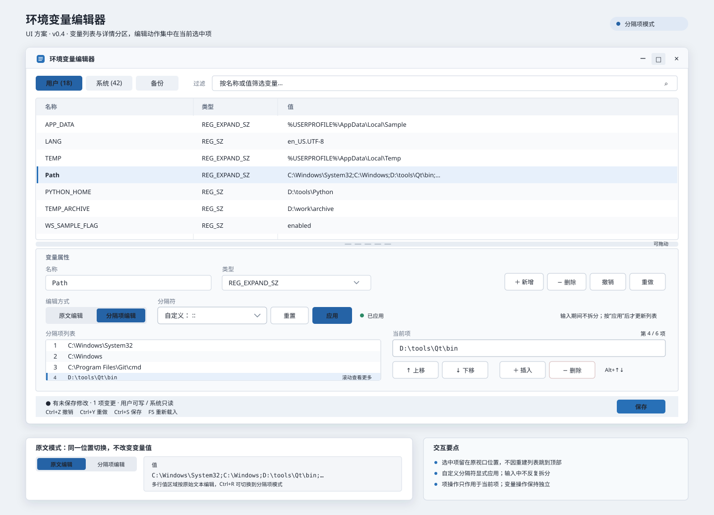
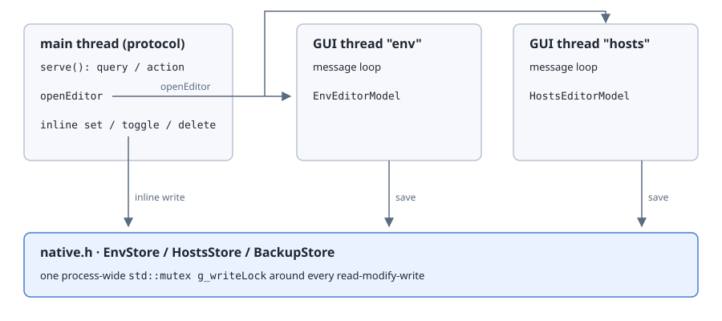
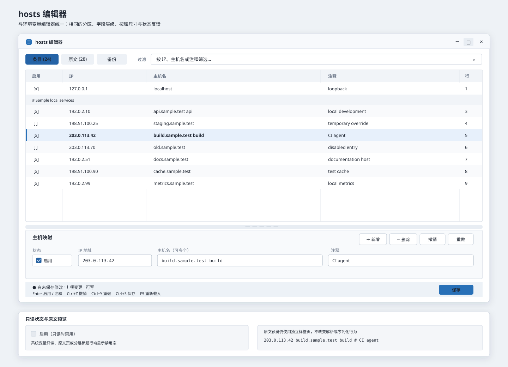

# ra9fael.envhosts — interactive editor window (v0.2 → v0.4 design)

Status: **implemented (v0.4.0).** Coded in `editor_win.h` (window + GUI thread),
`editor_model.h` (pure data model, 73 unit checks), wired into `main.cpp` (pinned
first row + `openEditor` action + external-change + shutdown join), `plugin.json`
(`ui` + `clipboard:write`, `idleExitSec: 0`), `README.md`, and `integration.py`
(P1–P6). Verified on a real Windows host via `tests/integration.py` (32/32 pass),
`editor_model.h` unit checks (73/73), `logic.h` unit tests (69/69) and the 30
assertions of `tests/gui_preview.py`. The three passes below are the design
history: v0.2.1 virtual scrolling and the status bar, v0.3.0 the split pane and
delimited-item editing, v0.4.0 the delimiter combo, the stable item viewport and
the save-conflict fixes.

**GUI verification (corrected):** the window was opened on a real desktop and
captured with GDI `PrintWindow` for both `env` and `hosts`. The first capture
exposed real rendering defects, which were fixed in `editor_win.h`:
`WM_NCCREATE` returned FALSE because `m_hwnd` was still null during creation
(`gle 1400` — this was a code bug, NOT a headless limitation); `loadModel()`
never called `rebuildVisible()` so the table had no rows; the outer/client rect
mismatch clipped the status bar; fonts were never selected into the DC; filter
text and Tab switching did not refresh the visible rows; `refreshDetail()` fired
`EN_CHANGE` and falsely marked the model dirty; edit controls lacked a border.
After the fix both windows render populated, column-aligned tables with a
visible detail panel and status bar, and live filtering / Tab switching were
exercised. `CreateWindowExW` does succeed in this session; the earlier
"headless" conclusion in the original design note was wrong.

Remaining manual sign-off: keyboard feel, save/conflict dialogs, and the
foreground-activation behaviour when opened from a launcher `action`.

### GUI refinement pass (v0.2.1)

Three issues reported from the first screenshots, all fixed in `editor_win.h`
and verified by driving the real window through `tests/gui_preview.py`.

1. **Virtual scrolling.** The table painted only the first screenful because
   `paint()` broke at `m_rcTable.bottom` with no viewport offset. It now keeps
   `m_topRow` (index into `m_visible`, or `m_backupIds` on the backup view),
   `pageRows()`, `ensureVisible()`, `clampScroll()` and `syncScrollbar()`.
   `WM_VSCROLL` (line/page/thumb/top/bottom), `WM_MOUSEWHEEL` (honouring
   `SPI_GETWHEELSCROLLLINES`), Home/End/PgUp/PgDn and the mouse hit test all use
   the same offset. The window keeps `WS_THICKFRAME | WS_VSCROLL` and defaults
   to a 960x620 client area; column widths are proportional so resizing works.
   Tab captions show row counts and the status bar shows `rows a-b / N`, so a
   clipped list can no longer be mistaken for a partial load.
2. **Per-row add/delete/edit.** The model already had `addNew`, `removeRow`,
   `toggleDeleted`, `setVar`/`setField` and a 200-step undo stack, but clicking a
   row immediately moved focus into an EDIT control, so `WM_KEYDOWN` never
   reached the window. Clicking a row now keeps focus on the table; Enter/F2
   enters the detail pane; Esc returns. Detail and filter controls are
   subclassed to forward Ins/Del/PgUp/PgDn/F5/Tab/Ctrl+Z/Y/S to the window.
   Keyboard, four detail buttons and the status chips all call the same
   `doAdd/doDelete/doUndo/doRedo/doEdit` commands. `Ins` clears an incompatible
   filter and scrolls the new row into view; `Del` toggles a deleted marker on
   existing rows (Del again restores) and removes an unsaved new row outright.
   `EN_CHANGE` now produces **one undo step per edit session** (400 ms idle,
   row change or save ends it) instead of one per keystroke, and no longer
   rebuilds the filtered view mid-typing. Ctrl+S shows the actual change list.
3. **Two-row status bar.** 24px -> 48px. Row 1 carries state, visible range,
   filter, scope/writability and transient messages; row 2 is a strip of
   clickable shortcut chips with disabled states. `setStatus()` messages now
   expire after 4 s (`kTimerStatus`) instead of permanently replacing the whole
   status line. Colours: info blue, warning amber, error red, success green.

Hosts comment-only lines are shown as full-width group headings (not squeezed
into the 8% "enabled" column) and are not editable. They are hidden while a
filter is active; saving still reproduces them byte for byte.

Verified with `tests/gui_preview.py`: 34 env rows -> two `SB_PAGEDOWN` messages
move the view to `rows 19-34 / 34`, `Ins` adds and scrolls to a highlighted new
row, `Del` removes it, and both windows render the two-row bar without overlap.

### Split env pane and delimited-item editing (v0.3.0)

The env window is now two vertically resizable panes: the variable table on top,
the detail editor below, separated by a draggable splitter. Only the env window
(non-backup tabs) is resizable; hosts and the backup view keep the fixed
112px detail strip, so the splitter geometry never leaks into the other layouts.

1. **Splitter.** `computeLayout()` derives `m_rcTable` / `m_rcDetail` /
   `m_rcSplitter` from `m_splitterY`, clamped so each pane keeps its minimum
   (list 112px, detail 200px); `WM_GETMINMAXINFO` enforces the smallest window
   that can hold both. Dragging uses `WM_LBUTTONDOWN` on the grip band +
   `SetCapture` + `WM_MOUSEMOVE`/`WM_LBUTTONUP`/`WM_CAPTURECHANGED`, and
   `WM_SETCURSOR` shows `IDC_SIZENS`. `applyLayout()` deliberately does not
   re-read the controls, so a drag or a resize never resets the caret or the
   text being typed.
2. **Item editing of a delimited value.** `editor_model.h` gained
   `splitDelimited` / `joinDelimited` (quote-aware, empty segments preserved);
   `pathSplit` / `pathJoin` are now `;` wrappers over them, so the round trip
   `join(split(v)) == v` is unit-tested for `;`, `,`, `:` and TAB.
3. **Explicit mode switch.** List mode is entered by the user, never inferred:
   `Ctrl+R` or the self-drawn `分隔项编辑 / 原文编辑` button toggles it (the
   button pair became the `原文│分隔项` segment in v0.4, and the cycling
   `分隔符` button became a preset + free-text combo there — see the v0.4.0
   section). `Path`/`PATH`-named rows are pinned to
   `;`. Switching to list mode splits the current value; switching back joins
   the items into the raw box, so the two views are always the same string.
   Items are edited with `Ins` (insert after the selection), `Del`,
   `Alt+Up/Down` (reorder) and the item box beside the list; every change
   rejoins into the model value and stays inside the one-undo-step-per-session
   rule. Read-only rows (system scope) get a read-only item box and list.

Not implemented from the original §4 mockup: expansion preview with ✓/✗
existence badges, `去重` and `删不存在`. The mode is entered explicitly instead
of auto-detected from `;` or a name list, because silently splitting an
arbitrary value would make the raw text unreachable.

Verified with `tests/gui_preview.py` on the real desktop: splitter drag, item
list of a 7-segment `Path`, `Ins` + typed item text (`D:\new\item` appears in
both the list and the rejoined value), `Del` removes it, and toggling back to
raw shows the original 7-segment string.

Scope: the pinned first row of the `env` and `hosts` result lists, and the
window it opens. The v0.1 inline (launcher) editing stays as it is.

### Custom delimiters, a stable item viewport and honest conflict detection (v0.4.0)

Four defects reported against the v0.3 env detail pane, plus the focus and reload
behaviour they exposed.

1. **The delimiter is data, not a cycle.** The `分隔符` button used to step
   through `; , : TAB |`, so a value separated by anything else — `=>`, a
   multi-character string — could not be reached at all. It is now a
   `CBS_DROPDOWN` combo: five localised presets plus free text, with an explicit
   `应用 / Apply` flat button. `delimiterValueForText` maps a preset label back
   to its character, so the combo can display `分号 (;)` while the model holds
   `;`. Nothing re-splits until Apply fires: `applyDelimiter()` rejoins the
   current items with the *old* delimiter first and only then splits on the new
   one, so `;` → `=>` → `;` returns the byte-identical value
   (`test_editor_model.cpp` asserts the round trip and the quoted-segment
   variant). The choice is remembered per `<scope>/<name>` in `m_delimPrefs`.
2. **Selecting an item keeps its viewport.** Every commit used to rebuild the
   list with `LB_RESETCONTENT` and re-assert `LB_SETTOPINDEX(m_partSel)`, which
   scrolled the selection back to the first row. Win32 has no
   `LB_UPDATESTRING`, so `updatePartRow()` now deletes and re-inserts the single
   index under a `PartsGuard` depth counter, and `LBN_SELCHANGE` reads the list's
   own new cursor *before* `commitPartEdit()` runs — otherwise the commit's
   re-selection would fight the click that triggered it.
3. **One control row, one style.** The mode toggle, the delimiter combo and
   `Apply` share a row: `drawFlatButton` paints the two mode cells and `Apply`
   with the same geometry, hover/pressed state and disabled colour as the item
   buttons, and the native combo is sized to the same 22px band. Dark theme is
   applied to every child through `WM_CTLCOLOR{BK,EDIT,STATIC}` with persistent
   brushes released in `WM_DESTROY`. `Tab`/`Shift+Tab` walk the field chain
   (env: 名称 → 类型 → 分隔符 → 值 → 列表 → 项输入框; hosts: 启用 → IP → 主机名 →
   注释 → 原文) and hand off to the table at either end, so the keyboard never
   gets stuck in a field.
4. **Save conflicts on what it can actually write.** Only the user scope (HKCU)
   is writable from this window, but the guard compared the *full* system+user
   fingerprint, so any unrelated HKLM change cancelled every save with
   `外部已修改，已取消保存`. It now compares `EnvModel::computeUserFingerprint`
   against the freshly read live snapshot, and the dialog is Abort / Retry /
   Ignore: abort writes nothing, retry reloads and asks you to re-apply, ignore
   force-writes. `MessageBoxW` runs with `native::g_writeLock` released, because
   a modal dialog left holding that lock blocks the protocol thread. Afterwards
   the model is rebuilt from `store.read(m_args.showSystem)` — reading with
   `false` used to drop every system-variable row from the table on save.

Reload is now a first-class action: `F5` calls `doReload()`, which confirms
before discarding unsaved edits and lands back on the same row
(`currentRowRef` → `selectByRef`), while an external change arriving while the
window is clean reloads silently and one arriving while it is dirty only raises
the `m_extChanged` marker — your edits are never overwritten behind your back.

Four things in that picture were deliberately not built, because the shipped
window already answers them another way: the delimiter combo has no separate
`重置` button (its five presets *are* the reset), no `已应用` dot (the status
line prints `分隔符: ;` instead), the item list has no row-number gutter (the
`当前项 9 / 28` counter covers it), and `保存` stayed a `Ctrl+S 保存` chip in the
shared shortcut row rather than a button in the status bar, so env and hosts
keep one bottom band. The segmented labels are shortened to `原文│分隔项`.

Verified with `tests/gui_preview.py`: 30 assertions over the real window — the
layout mirror matches the combo's own rect, a 28-segment `Path` splits into 28
items, clicking the last visible item keeps `topindex` 8, editing it updates that
row only, `=>` collapses the value to one item and `;` restores it byte-for-byte,
the rejoined raw box matches, saving through the shortcut chip writes and reads
back, the 系统 tab still has its rows, an external write yields Abort with the
external value intact, and `F5` asks before discarding.

### v0.4.1 fix pass

Root causes found after a desktop review, each fixed in `editor_win.h` /
`editor_model.h`:

| Symptom | Cause | Fix |
|---|---|---|
| User variables could not be edited | `loadModel()` applied a leftover draft silently; that draft had marked `Path` deleted, and `rowEditable()` is false for deleted rows | `offerDraft()` asks 恢复 / 丢弃 once the window is visible (丢弃 deletes the file); a deleted row shows a red notice in the detail pane |
| Delimiter control looked unlike 原文│分隔项 / 应用 | native `COMBOBOX` with `WS_EX_CLIENTEDGE`; the toolbar row also overlapped 名称/类型 by 2px | self-drawn dropdown button + `TrackPopupMenu` presets (applied at once); `自定义…` shows a flat EDIT in the same slot; toolbar moved to `top+48` |
| Active 分隔项 cell blank | `Rectangle()` filled with the default white brush over the accent fill | border drawn with `NULL_BRUSH` |
| Red read-only banner on hosts | duplicated the status line and covered y 30–50 (table top, backup list) | banner only for real errors; status says `只读（需管理员）` |
| hosts 启用 font | the checkbox never got `WM_SETFONT` | set the UI font; light-theme `WM_CTLCOLORSTATIC` returns the panel brush |
| hosts samples counted as entries | `# 102.54.94.97 rhino.acme.com` parses as a commented host spec | `findHeaderEnd()` folds a leading comment block that starts with prose into one header row; serialisation copies it byte-exact |
| Bogus `enable line N` changes | `changeList()` compared section rows' comment state | headings are skipped |
| Duplicate host names unnoticed | — | `duplicateFlags()` marks later enabled lines `!`; status bar counts them |
| 原文 tab empty, no column headers | nothing set `m_rawEdit`'s text; `drawHeader()` was never called | raw tab shows `serializeWork()`; header band drawn |

`tests/gui_preview.py` covers the delimiter menu commands (200–205), the hidden
custom box, the raw tab text and a duplicate line; `test_editor_model.cpp` adds
the header fold, byte-exact round trip, leading-disabled-entry and old-draft
re-fold cases (86 checks).

### Editable raw tab

D3 was revised from "read-only preview" to editable text with parse-back.

- **Model.** `HostsModel` keeps two texts. `disk` is the file as read, used for
  dirtiness (`serializeWork() != disk`), the conflict fingerprint and backups.
  `base` is what the rows index into. `applyRaw(text)` replaces `base` and
  rebuilds every row; `disk` is untouched. An undo step is a `Snapshot` of
  `base` + rows + header, so one raw edit undoes in one step. A draft written
  after a raw edit carries `baseText`.
- **Format.** The EDIT shows CRLF. `applyRaw` drops the CR, re-applies the
  file's dominant ending to changed lines, keeps each unchanged line's own
  ending, and keeps the BOM and trailing-newline state. An unchanged text is a
  no-op (no undo step, not dirty).
- **When it applies.** Leaving the tab (click, Ctrl+Tab), Ctrl+S, and close /
  draft autosave call `commitRaw()`. No separate Apply button: like every other
  edit in this window it only changes the working copy, and Ctrl+S still
  confirms the real write.
- **Change list.** After a raw edit rows no longer map 1:1 to disk lines, so
  `changeList()` falls back to an LCS line diff (`+ line` / `- line`).
- **Keys.** Inside the box Ctrl+Z / Ctrl+Y are the EDIT's own text undo, Tab
  inserts a tab, Ctrl+A selects all, Ctrl+S saves, Esc closes. The Ins / Del /
  Enter / undo chips are disabled on this tab.
- **Layout.** No detail strip on this tab; the box ends 8px above the status
  bar and the window's own scrollbar is hidden. The tab count is the file's
  line count; the status line shows `第 n 行 / 共 m 行 · 原文已修改`.
- **Invalid text** is allowed while typing; after it is applied the bad rows
  block Ctrl+S through the existing `hasInvalid()`.

### Decisions taken (D1–D4)

- **D1** → (a) notify only. On `CreateWindowExW` failure the `openEditor` action
  returns `notify` + `keep`, so the launcher stays open and the existing rows
  below remain usable. `tests/integration.py` (P3) verifies the failure path
  returns `notify` + `keep`; on a real desktop the window opens normally.
- **D2** → revised in v0.4.2 to (b). The plugin declares `elevated` (requires
  Win顺 ≥ 0.22.0 via `minWinShun`, the unreviewed-native floor): when Win顺 runs as administrator and the user
  confirmed the plugin card once, the plugin starts elevated and the 系统 tab,
  the launcher's system-var delete and hosts writes all work. Write access still
  follows a real probe (`canWriteSystem` / `isWritable`), never the token alone;
  the plugin never shows UAC itself. The status bar's ⓘ explains the current
  permissions and the two confirm steps.
- **D3** → revised in v0.4.1 to (b). The hosts 原文 tab is editable when hosts is writable; the text is parsed back into the model when you leave the tab, press Ctrl+S or close. See "Editable raw tab" above.
- **D4** → (a) `clipboard:write` is requested for Ctrl+C inside the window.

Sources used for this design (read, not assumed):

- `WinShun/docs/plugins.md` — "有自己窗口的常驻插件" (own-window resident
  plugins), item fields, effects, `ui` / `sandbox` / `idleExitSec` semantics.
- `ra9fael.binarylab/editor.h` (sibling repository) + `ROADMAP.md` — the working GDI window pattern
  (dedicated GUI thread, `openEditorWindow` / `editorVisible` /
  `closeEditorAndWait`, spike measurements).
- `ra9fael.envhosts/{main.cpp,logic.h,native.h,plugin.json}` — current v0.1.

---

## 1. The pinned first row

### 1.1 Rule

Every response of the `env` and `hosts` commands starts with exactly one row
that opens the editor. "Every" includes list, filter, `set` / `add` preview,
`backup`, empty-result and error responses. The rest of the list is unchanged
v0.1 output.

| Field | `env` | `hosts` |
|---|---|---|
| `id` | `env:editor` (stable, never changes) | `hosts:editor` |
| `title` | 进入交互式编辑界面 | 进入交互式编辑界面 |
| `subtitle` | `用户 12 · 系统 34 · 过滤：path` | `启用 9 · 注释 4 · 只读` / `可写` |
| `icon` | same colour as the command | same colour as the command |
| `score` | 100 | 100 |
| `actions` (item-level, overrides the command's) | `[{id:"openEditor", key:"Enter"}]` | same |
| `data` | `{kind:"env", filter, select, draft}` | `{kind:"hosts", filter, select, draft}` |
| `valid` | true (even when the rest is an error) | true |

`data` carries the launcher context into the window:

| Query | `filter` | `select` | `draft` |
|---|---|---|---|
| `env` / `env path` | `""` / `"path"` | — | — |
| `env set FOO=bar` | `"FOO"` | `user/FOO` | `{name:"FOO", value:"bar"}` (shown as an unsaved change) |
| `hosts docker` | `"docker"` | — | — |
| `hosts add 127.0.0.1 a.test` | `"a.test"` | — | `{ip, host}` (unsaved new row) |
| `env backup` / `hosts backup` | `""` | — | opens on the 备份 tab |
| error rows (`E_HOSTS_UTF16`, read failure) | `""` | — | window opens read-only with the error banner |

The window never writes because of `data`. A `draft` is only an unsaved edit;
the user still has to save.

### 1.2 Why item-level actions

The command-level `actions` bind Enter to `edit` (env) / `toggle` (hosts).
Item-level `actions` override them for this row only, so Enter on row 1 opens
the window and Enter on any other row keeps v0.1 behaviour. Ctrl+Enter and
Shift+Enter are not bound on row 1.

---

## 2. Host integration

### 2.1 Manifest changes

| Field | v0.1 | v0.2 | Reason |
|---|---|---|---|
| `permissions` | `files:read`, `files:write` (hosts) | + `ui` | Docs: a resident plugin that opens its own window must declare `ui`, or manifest validation fails. |
| | | + `clipboard:write` | Ctrl+C inside the window copies directly. Host `copy` effects only exist in `action` replies, and the window acts outside those. Drop this if the window gets no copy commands. |
| `runtime.idleExitSec` | 600 | **0** | Idle counts protocol traffic. A user editing for 10 min sends no queries, and `shutdown` would close the window. binarylab uses 0 for the same reason. |
| `runtime.start` | `lazy` | `lazy` (unchanged) | No hotkey or push. The process starts on the first `env` / `hosts` query, which always comes before the editor row can be pressed. |
| `runtime.sandbox` | `normal` | `normal` (unchanged) | Medium integrity is needed for HKCU writes and hosts. It also avoids the open UIPI question binarylab has under `strict` (ROADMAP Q1). |
| `version` | 0.1.0 | 0.2.0 | Permission change. The host asks the user to confirm the new permissions again. |

`elevated` **is** declared as of v0.4.2 (revised decision D2 in section 9); it
needs Win顺 ≥ 0.22.0, which `minWinShun` states.

### 2.2 Opening the window

`action("openEditor")` handler:

1. Parse `data` into an `EditorSpec` (kind, filter, select, draft, locale,
   theme, settings snapshot). The GUI thread never reads `settings()`.
2. If the window for this kind is already open: post `WM_APP_FOCUS` with the
   new spec (apply filter/select, keep unsaved edits), return.
3. Otherwise `openEditorWindow(spec, error)`. The wait drops from binarylab's
   3 s to **1000 ms** because `timeoutMs` is 1500. Window creation took about
   10 ms in the binarylab spike.
4. Reply `[notify("已打开编辑窗口（Esc 关闭）"), hide]`, or on failure
   `[notify("无法打开编辑窗口：" + error), keep]`.

One window per kind. `env` and `hosts` may be open at the same time, each on
its own GUI thread (binarylab allows one window; this generalises it to a
small `kind → state` map).

### 2.3 Foreground (the main risk)

The docs say the host calls `AllowSetForegroundWindow` before `menu`,
`picture`, `showSettings` and `hotkey`. They say nothing about `action`. When
Enter is pressed the launcher owns the foreground, so a plain
`SetForegroundWindow` from the plugin may fail. The window then appears
behind other windows with only a flashing taskbar button.

Plan, in order, decided by measurement (test W1):

| Step | What | Keeps rules? |
|---|---|---|
| a | `ShowWindow(SW_SHOWNORMAL)` + `SetForegroundWindow`. Check `GetForegroundWindow() == hwnd` 100 ms after the host's `hide`. | yes |
| b | If (a) fails: return `keep` instead of `hide`, so the launcher stays foreground while the window is created, then the launcher is hidden by the user. | yes |
| c | If (b) is still poor: route opening through `showSettings` (the card's 设置 button) as a second entry point, which is documented to allow foreground. | yes |

Not used: `AttachThreadInput`, fake key presses (`keybd_event` Alt trick), or
`SystemParametersInfo(SPI_SETFOREGROUNDLOCKTIMEOUT)`. These work around the
foreground lock against Windows' intent.

---

## 3. Architecture

New files:

| File | Content | Depends on Win32? |
|---|---|---|
| `editor_model.h` | Working copy, dirty tracking, undo stack, validation, PATH split/join, conflict check, change list for the save dialog | no (unit-tested) |
| `editor_win.h` | Window, controls, keyboard map, painting, theme | yes |
| `main.cpp` | Pinned row, `openEditor` action, `WM_APP_EXTERNAL_CHANGE` after inline writes, close-and-join in the destructor | — |

Rules carried over from binarylab:

- The GUI thread writes nothing to stdout. Only the protocol thread talks
  JSON-RPC.
- Settings, locale and theme are snapshotted into the spec. `appearance`
  notifications are forwarded with `PostMessage(WM_APP_THEME)`.
- On `shutdown` and in the destructor: post `WM_CLOSE` to each window, wait up
  to 1500 ms, join. Unsaved edits go to drafts (section 6.4), never to the
  registry or hosts.

### 3.1 Control choice

| Option | Keyboard / screen reader | Theme fit | Effort |
|---|---|---|---|
| **A. Win32 common controls** (ListView report mode, Edit, ComboBox, Tab) | Free: Tab order, arrow keys, F2 rename, UIA from the OS | Light is native. Dark needs `DwmSetWindowAttribute(DWMWA_USE_IMMERSIVE_DARK_MODE)` for the title bar and `ListView_SetBkColor/TextColor`; headers stay partly light | medium |
| B. Custom GDI grid (binarylab style) | Must be written by hand | Full control | high |

**Choice: A.** This is a table editor, and the keyboard and accessibility
requirements come for free with ListView. Option B is worth it only for
binarylab's bit grid, which has no standard control. Dark-mode gaps are
listed as a known limitation.

---

## 4. env window

Title: `环境变量 — Win顺`. Default size 960×600 DIP, remembered in
`WS_DATA_DIR/editor.json` (position, size, column widths, last tab).

The shipped window is [EDITOR_DESIGN_v0.4.svg](EDITOR_DESIGN_v0.4.svg); the
table below is the authoritative description of each area.

| Area | Behaviour |
|---|---|
| Tabs | 用户 (editable), 系统 (editable when the plugin runs elevated — i.e. `canWriteSystem` passes; otherwise greyed editors), 备份 (list of `backups/env/*.json`, newest first). `showSystemVars=false` hides the 系统 tab. |
| Table | ListView report mode. Columns 名称 / 类型 / 值 (first line, truncated) / ● dirty marker. Sorted by name, case-insensitive. Filter matches name or value, the same rule as `envMatches`. |
| Detail pane | Edits the selected row. **List mode** is entered explicitly with `Ctrl+R` or the `原文│分隔项` segment (the value is never split silently, so the raw text always stays reachable); the delimiter comes from a preset menu or a custom text box (see "v0.4.1 fix pass" below). `Path`-named rows default to the `;` delimiter. Otherwise a multi-line Edit. |
| List mode items | One row per segment, in order, with the selected row and the viewport preserved across an in-place edit. `上移 / 下移 / 插入 / 删除` (or `Alt+↑↓`, `Ins`, `Del`) act on that segment only, and `当前项 n / m` reports the position. A draggable vertical splitter (7px grip, `IDC_SIZEWE`) sits between the list and the action pane; the split is stored as a percent (default 42, clamp 20–80) with hard minimums of 180px / 200px, so resizing the window keeps the ratio and neither side can collapse. `Ctrl+Shift+←/→` is the keyboard equivalent. No expansion or existence marks — those were dropped as v0.1 sketch. |
| 类型 | REG_SZ / REG_EXPAND_SZ. Auto-switches to EXPAND when `%X%` is typed (same as `envTypeForValue`), but the user can override. REG_MULTI_SZ rows are shown read-only (v0.1 also does not edit them). |
| Validation | Live, from `isValidEnvName` / `isValidEnvValue`: red border and status text. Save is disabled while any row is invalid. Length counter turns amber above 1024 (a later `setx` by any other tool truncates there) and red above 32767 (the Windows limit for one variable). |
| New / delete | Ins adds a blank row with the name focused. Del marks the row deleted (red text, `Del 恢复` chip, a red notice in the detail pane); the row stays read-only until Del is pressed again. An unsaved new row is removed outright. Nothing reaches the registry until `Ctrl+S`. |

---

## 5. hosts window

Title: `hosts — Win顺`. Default 900×560 DIP.

The picture is the shipped layout. Two things from the v0.1 sketch were never
built and are described in the table as they actually behave: there is no path
/ encoding / line-ending header band (writability shows in the status line),
and there is no **打开文件位置** button — see D2.

| Area | Behaviour |
|---|---|
| Writability | Probed with the same write test as v0.1 when the window opens and again before each save, then reported in the status line as `· 可写` / `· 只读`. There is no path / encoding / line-ending header band. |
| Read-only state | When the probe fails every edit control is disabled (`m_args.writable` gates the editors, the raw text box, 新增 and toggle) and the status line says `只读（需管理员）`. Navigation, filter, copy and the 原文 view keep working. No **打开文件位置** button, no UAC prompt — the elevated permission (D2) makes hosts writable when Win顺 runs as administrator with the card confirmed. |
| UTF-16 file | Same as v0.1: `E_HOSTS_UTF16` banner, the whole window is read-only, no conversion offer. |
| 条目 tab | One row per `HostsEntry`. Section dividers (comment-only lines) are shown as group headings, not as rows. Blank lines and free comments are not shown but are kept by line index, so saving reproduces them byte for byte. |
| Columns | 启用 (checkbox = not commented), IP, 主机名, 注释 (trailing `#…`), 行 (1-based line number), ● dirty / ! invalid. In-place edit with F2 or double-click (ListView label edit for 主机名, an overlay Edit for other cells). |
| Lines with several hostnames | v0.1 `parseHostLine` keeps only `tok[1]`. The editor needs all of them, so the model gets `std::vector<std::string> hostnames` and the cell shows `a.test b.test`. Editing re-joins with one space. Only edited lines are re-serialised; others stay raw. |
| Validation | `ipv4Valid`, an IPv6 check, `hostValid` per hostname. Warnings, not errors: the same hostname enabled on two lines (the first one wins, so the second does nothing), `0.0.0.0` vs `127.0.0.1` duplicates. |
| 原文 tab | Monospace (Consolas) text of the file as it will be written, filling the work area down to the status bar; only the text box scrolls. Editable when hosts is writable and not UTF-16, read-only otherwise. See "Editable raw tab". |
| New row | Ins adds `127.0.0.1` + focused empty hostname at the end of the current group (or at the file end when no group is selected). |

---

## 6. Edit, save and conflict model

### 6.1 Working copy

`editor_model.h` holds three things per window:

| Name | Content |
|---|---|
| `base` | What was read from disk/registry when the window opened or last saved, plus a fingerprint: env = FNV-1a over sorted `scope/name/type/value`; hosts = file size + last-write time + FNV-1a of the bytes. |
| `work` | `base` + the user's edits. Dirty = `work != base` per row. |
| `undo` / `redo` | Stack of edit commands (set cell, add row, delete row, toggle, move segment), max 200. Ctrl+Z / Ctrl+Y. Cleared on save. |

Nothing is written while editing. All writes happen in **保存**.

### 6.2 Save sequence

1. Validate `work`. Any invalid row: stop, focus the first one.
2. Show the change list (modal, keyboard-first): `+ FOO = bar`,
   `~ Path: 3 段 → 4 段`, `- OLD_VAR`, `第 25 行 启用 → 注释`. Enter
   confirms, Esc returns to editing.
3. Take `g_writeLock` (shared with the inline v0.1 actions on the protocol
   thread).
4. Re-read the target and compare its fingerprint with `base`.
   - Same: continue.
   - Different: **conflict** (6.3). Release the lock and stop.
5. Back up with `BackupStore` (same rotation as v0.1, same `backupCount`).
   Backup failure stops the save.
6. Write:
   - env: only changed rows, one `RegSetValueExW` / `RegDeleteValueW` each,
     type kept unless the user changed it. Then one `WM_SETTINGCHANGE`
     broadcast, not one per variable.
   - hosts: serialise `work` (untouched lines raw) and write in place, as in
     v0.1 (keeps the ACL, not atomic).
7. Re-read, set `base = work = disk`, clear undo, release the lock.
8. Status bar: `已保存 3 项 · 备份 2026-11-05_2310.json`.

A partial env failure (for example, the 2nd of 3 writes fails) is reported
row by row. The rows that were written stay written, and the backup from
step 5 can restore all of them. This is stated in the status text, not
hidden.

### 6.3 External changes and conflicts

| Source | Detection | Behaviour |
|---|---|---|
| Inline v0.1 action in the launcher (same process) | The protocol thread posts `WM_APP_EXTERNAL_CHANGE` after its write. | If the window has no unsaved edits: reload silently. Otherwise: yellow bar `外部已修改，[重新载入] [查看差异]`. |
| Another program edits env | `RegNotifyChangeKeyValue` on `HKCU\Environment` (event, waited on by the GUI thread with `MsgWaitForMultipleObjects`) | Same as above. |
| Another program edits hosts | `FindFirstChangeNotificationW` on the `etc` folder, filtered by the fingerprint | Same as above. |
| Missed notification | The fingerprint check in save step 4 | Conflict dialog: 重新载入（丢弃我的修改） / 查看差异 / 取消. There is no "overwrite anyway" in v0.2. |

Re-basing (merge the user's edits onto the new disk state) is out of scope.
查看差异 shows `disk` and `work` side by side for the changed rows only.

### 6.4 Closing, shutdown, and drafts

| Event | Unsaved edits? | Behaviour |
|---|---|---|
| Esc / ✕ / Alt+F4 | no | Close. |
| | yes | Dialog: 保存 (S) / 不保存 (N) / 取消 (Esc). Default button 取消. |
| `shutdown` from host, plugin disabled, WinShun exit | yes | No dialog (the host waits only a short time). Write `work` as a draft to `WS_DATA_DIR/drafts/<kind>.json`, close, join. Never write to the registry or hosts. |
| Next open with a draft present | — | Dialog `发现上次未保存的修改（N 项）` with 是 (restore) / 否 (discard, deletes the file). Restore applies the draft as unsaved edits on top of a fresh read. Never applied silently. |
| Process killed (crash, job end) | yes | Lost. Drafts are also autosaved every 30 s while dirty, so at most 30 s of edits are lost. |

### 6.5 Backups tab

Same tab in both windows. Lists backups newest first with time, size, and
the number of rows that differ from the current state. Enter on a backup
loads it **into `work` as unsaved edits**, so the user sees exactly what
restore will change and must still press 保存. This replaces v0.1's
direct "restore" for the window path. The launcher path stays as it is.

---

## 7. Keyboard map (everything works without a mouse)

| Key | Where | Action |
|---|---|---|
| Tab / Shift+Tab | detail field | Next / previous field in the pane; at either end it hands focus to the table |
| Tab | window | Next view (用户 / 系统 / 备份, or 条目 / 原文 / 备份) |
| Ctrl+Tab / Ctrl+Shift+Tab | window | Next / previous tab (用户 / 系统 / 备份, or 条目 / 原文 / 备份) |
| Ctrl+F | window | Focus the filter; Esc in the filter clears it, a second Esc goes back to the table |
| ↑ ↓ PgUp PgDn Home End | table | Move selection |
| Enter / F2 | table | Edit the selected row (env: focus value; hosts: focus hostname) |
| Space | hosts table | Toggle 启用 |
| Ins / Del | table | Add a row / toggle the deleted marker (Del again restores); an unsaved new row is removed outright |
| Alt+↑ / Alt+↓ | env list mode | Move a PATH segment |
| Ctrl+Shift+← / → | env list mode | Move the item list / action pane splitter by 5% (mouse: drag the vertical grip) |
| Ctrl+R | env detail | List mode ↔ raw text |
| Ctrl+C | table | Copy the value (env) or the full line (hosts) |
| Ctrl+Shift+C | env table | Copy the expanded value |
| Ctrl+Z / Ctrl+Y | window | Undo / redo |
| Ctrl+S | window | Save (opens the change list) |
| F5 | window | Reload from disk (asks first when dirty) |
| Esc | table | Close the window (asks first when dirty) |
| Esc | detail / filter | Return focus to the table; in the filter it also clears the text |
| Alt+underlined letter | dialogs | Buttons (保存(&S) 不保存(&N)) |

Focus is always visible (system focus rectangle plus a highlighted row).
All controls have accessible names so Narrator reads 名称, 值, 启用.

---

## 8. Appearance, DPI, privacy

- Theme and locale from `initialize.appearance` and later `appearance`
  notifications (sent only to `ui` plugins). Light: system colours. Dark:
  immersive dark title bar + ListView/Edit colours; tab and header controls
  may stay light (known gap of option A).
- Per-monitor DPI v2 (`SetProcessDpiAwarenessContext`), `WM_DPICHANGED`
  re-layout. Font: `Segoe UI` / `Microsoft YaHei UI` for text, `Cascadia
  Mono` → `Consolas` for values and the 原文 tab.
- Data written by the editor: `WS_DATA_DIR/editor.json` (window layout),
  `drafts/*.json` (unsaved edits, may contain env values), plus the v0.1
  `backups/`. README gets a line that drafts can contain secrets such as
  tokens in env values and are deleted after save or discard.
- No network, no other processes, no hooks, no window enumeration. The `ui`
  permission is used only to create the plugin's own windows.

---

## 9. Decisions for you

| # | Question | Options | My recommendation |
|---|---|---|---|
| D1 | What does row 1 do when the window cannot open (old host, foreground fails)? | a) notify only; b) fall back to v0.1 inline list | a), plus the existing rows remain usable below it |
| D2 | System env and protected hosts | a) read-only + banner (no new permission); b) add `elevated`: writable only when WinShun itself runs as admin, never a UAC prompt | b) since v0.4.2 — the permission is declared (`minWinShun` 0.22.0) and the write gate stays a real probe. The status bar's ⓘ explains the two-step confirmation. |
| D3 | hosts 原文 tab editable? | a) read-only preview; b) full text editing with parse-back | a) in v0.2; b) since v0.4.1, with the `disk` / `base` split described under "Editable raw tab". |
| D4 | Keep `clipboard:write`? | a) yes, Ctrl+C in window; b) no, copy only from launcher rows | a) — copying a value is the most common action |

---

## 10. Test plan

Same layering as `envhosts-plugin-design.md` (L0 manifest … L5 real host).
New cases only. All write tests use the existing overrides
`WS_ENVHOSTS_TEST_SUBKEY` (scratch `HKCU\Software\…` key) and
`WS_ENVHOSTS_TEST_HOSTS` (temp file); the GUI suite also sets
`WS_ENVHOSTS_TEST_SYSTEM_SUBKEY` to an `HKCU\…` path, so the 系统 tab renders
fake rows instead of this machine's real HKLM variables. The real registry and
the real hosts are only read, except in the documented manual case M5.

### 10.1 L1 — model unit tests (`tests/test_editor_model.cpp`, no Win32)

| ID | Case | Expected |
|---|---|---|
| U1 | Pinned row present for: list, filter, `set` preview, `add` preview, `backup`, empty, `E_HOSTS_UTF16`, read failure | `items[0].id` is `env:editor` / `hosts:editor`, `valid` true, item-level Enter = `openEditor` |
| U2 | `data` for `env set FOO=bar` and `hosts add 127.0.0.1 a.test` | `filter` / `select` / `draft` exactly as in the table in 1.1 |
| U3 | PATH split/join round trip: `a;;b;`, trailing `;`, quoted `"C:\a;b"`, single segment | Join(split(x)) == x when unedited; edits only change the edited segment |
| U4 | Dirty tracking: edit then edit back | Row not dirty, change list empty |
| U5 | Undo/redo over 200 commands, cleared on save | Stack bound respected |
| U6 | hosts multi-hostname line `127.0.0.1 a b # c` | `hostnames == {a,b}`, comment `c`; untouched line serialises byte-identical |
| U7 | Save of the real fixture `hosts.real` with one toggle | Only that line differs (byte diff), BOM and CRLF kept |
| U8 | Fingerprint changes on: size, mtime, one byte; env: value, type, new var | Conflict detected in each case |
| U9 | Draft serialise/restore, including a value with `"`, `\`, CJK, 32767 chars | Identical after round trip |
| U10 | Backup loaded into `work` | Rows marked dirty, nothing written |

### 10.2 L3 — protocol (`tests/integration.py`, extended)

| ID | Case | Expected |
|---|---|---|
| P1 | `query env`, `query hosts`, `query hosts zzz-none` | Row 1 is the editor row in each response; v0.1 rows unchanged after it |
| P2 | `action openEditor` | Reply within 1000 ms: `notify` + `hide`; process alive; nothing extra on stdout (each stdout line parses as JSON-RPC) |
| P3 | `openEditor` twice | One window (count via `EnumThreadWindows` on the plugin's threads from the test harness), second call refocuses |
| P4 | Inline `env set` while the window is open and clean | Window reloads (checked through a test-only `WM_COPYDATA` "dump state" message in debug builds) |
| P5 | `shutdown` with unsaved edits | Process exits within 1500 ms, `drafts/env.json` exists, scratch registry unchanged |
| P6 | Manifest: `ui` present, `idleExitSec` 0, semantic version | Field check (same manual check as v0.1, no jsonschema) |

### 10.3 L4 — window automation (UI Automation, `tests/ui_editor.py`)

Driven with `pywinauto` (UIA backend) against the plugin started by the test
harness, then against the real host.

| ID | Case | Expected |
|---|---|---|
| W1 | **Foreground** after Enter on row 1 in the real launcher | `GetForegroundWindow()` is the editor 100 ms after the launcher hides. Decides step a / b / c in 2.3. |
| W2 | Keyboard only: open, Ctrl+F `path`, Enter, Ins segment, type, Ctrl+S, Enter | Scratch key value has the new segment, one backup file added, one `WM_SETTINGCHANGE` |
| W3 | hosts: Space on a row, Ctrl+S | Temp hosts differs only on that line |
| W4 | Invalid IP / env name | Save disabled; status shows the line; nothing written |
| W5 | External change while dirty (test edits the scratch key) | Yellow bar appears; save gives the conflict dialog; no write |
| W6 | Esc with edits | Dialog, default 取消; N closes without write |
| W7 | Read-only hosts (deny ACE on the temp file for the test user) | Banner, controls disabled, Ctrl+C still works |
| W8 | DPI 100 / 150 / 200 %, monitor move | No clipped controls (screenshot per step) |
| W9 | Dark / light switch while open | Colours update without reopening |

### 10.4 Four required situations

| Situation | env | hosts |
|---|---|---|
| Normal | W2 | W3 |
| Empty | Scratch key with no values: table empty, "没有变量，Ins 新增" | Empty temp file: same, save writes exactly the new line |
| Invalid | W4, U9 limits | W4, UTF-16 temp file → read-only window |
| Dependency unavailable | Scratch key missing / access denied → error banner, window still opens | Path setting points to a missing file → banner, no file created |

### 10.5 L5 — real WinShun, manual (human)

| ID | Steps | Check |
|---|---|---|
| M1 | Install 0.4.0, enable | Permission dialog lists `ui` (and `clipboard:write`) |
| M2 | Type `env`, `环境变量 path`, `hosts docker` | Row 1 is 进入交互式编辑界面 every time; Win顺 message log shows `query` / reply with `env:editor` first |
| M3 | Enter on row 1 | Window in front, focus in table (W1 by hand); message log shows `action openEditor` and the reply |
| M4 | Leave the window open 15 min, no queries | No `shutdown` in the log (idleExitSec 0) |
| M5 | Real user env: add `WS_TEST_TMP=1`, save; open a new terminal | `echo %WS_TEST_TMP%` prints 1; then delete it in the window and save |
| M6 | Disable the plugin while dirty | Draft saved; re-enable, reopen, 恢复 works |

### 10.6 Side-effect audit

After every automated run: export `HKCU\Environment` and hash the real hosts
before and after; both must be identical. The scratch key is deleted and the
temp files removed by the harness.

---

## 11. Not covered / unverified

- Whether WinShun allows the plugin to take the foreground from an `action`
  reply. Docs do not say; W1 measures it. Section 2.3 has the fallback.
- Whether the job object or UI restrictions block `RegNotifyChangeKeyValue`
  or `FindFirstChangeNotificationW` for a `normal` sandbox plugin. Not
  measured; save-time fingerprint check (6.2 step 4) is the backstop.
- The local `winshun.h` exposes `theme()` (light / dark) but no
  `appearanceChanged()` hook or `shuttingDown()`. Live theme switching (W9)
  needs either an SDK upgrade or handling the raw `appearance` notification;
  shutdown cleanup goes in the destructor, as in binarylab.
- `pywinauto` is not installed in the current Python; L4 needs it.
- The ListView dark-mode gaps in section 8 are expected, not measured.
