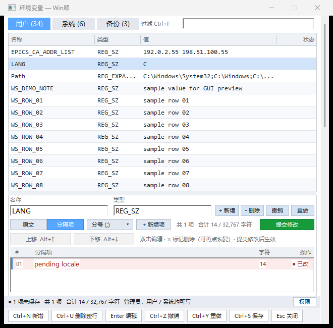
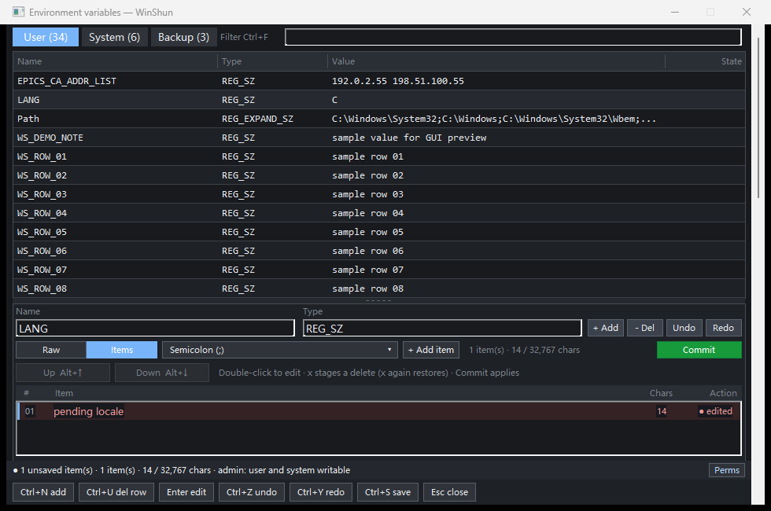

# envhosts native interaction validation

[简体中文](README.md)

## Problem

The user reported five defects in the 0.7.3 native editor: missing item Up/Down
buttons, clipped footer labels, reversed Vim directions and missing dd/gg/G,
a backup count that sometimes became zero on User, and navigation accepting
pending item operations. Tests ran on Windows x64 at 96 DPI with a MinGW Release
build. See the plugin's `NATIVE_INTERACTION_FIXES.en.md` and source hashes in
`results.json`.

## Cause

- Layout cleared the Up/Down rectangles and click dispatch omitted their actions.
- Footer buttons used fixed narrow widths and 16 px height without text measurement.
- Item J/K increments were reversed; dd/gg/G were not forwarded. Native character
  selection could also override navigation.
- The backup label used the scoped page list, initialized only on Backups; scope
  exclusion predicates were reversed.
- Item edits immediately changed the working model, while detail rebuilds cleared
  pending markers. Navigation therefore appeared to commit them.

## Changes

Restore visible Up/Down buttons with Alt+Up/Down labels and shared drawing/hit
rectangles. Measure footer labels using the actual font, reserve all delete/restore
variants, wrap when needed, and reserve footer height before laying out panes.

J/Ctrl+J move down, K/Ctrl+K up, and Alt+J/K reorder down/up. Add item dd/gg/G and
correct focus/WM_CHAR handling while retaining literal input in text fields.

Keep total backups separate from the scoped list; refresh on startup, Save and
deletion, and correct scope filtering. Per-variable candidates retain add/edit/
delete/reorder operations across navigation. Commit applies the current variable
as one model undo step. Save collects candidates and retains write confirmation.
Candidates have local undo/redo and persist in drafts. Candidate-only drafts also
prompt for recovery and support undo/redo after restoration.

## Measured results

| Layer / check | Expected | Actual / evidence |
|---|---|---|
| L0 archive | Correct manifest, files, limits and extracted executable | 0 failures; exe hash matches build; `package.txt`, `results.json` |
| L1 CTest | Logic, model and dialog layout pass | 3/3; `ctest.txt` |
| L2 protocol | Isolated registry/hosts, permissions and locale pass | 37/37 from checkout and extracted package; `results.json`, `package.txt` |
| L3 real host | Query/Enter opens the current native editor | Matching filter readback and exe hash; exit 0; `host-smoke.json` |
| L4 existing GUI | Save, backups, conflicts, hosts and keyboard remain correct | 145/145; `gui_regression.txt` |
| L4 interaction | Buttons, directions, backup total, candidates, draft and explicit Save | 51/51; `interaction.txt` |
| L4 split state | Navigation, undo, mixed selection, new items and delimiter remain consistent | 19/19; `split_state.txt` |
| L4 restore dialog | Complete body/buttons and correct restore/discard | Chinese/light and English/dark 8/8 each; `dialog_zh.txt`, `dialog_en_dark.txt` |

The 145-test existing GUI run preceded the final candidate-draft and maximum-label
width fixes. The 51-test interaction suite, both dialog suites and final CTest
cover those changes. Two initial host probes incorrectly used GetWindowTextW to
read another process's EDIT text. Switching the probe to WM_GETTEXT fixed the
readback; this required no product change.




Run from the plugin directory:

```powershell
cmake --build build --config Release
ctest --test-dir build -C Release --output-on-failure
python tests/integration.py
python tests/gui_preview.py --interaction-check --no-hold
python tests/gui_preview.py --split-state-check --no-hold
python tests/gui_preview.py --dialog-check --no-hold
python tests/gui_preview.py --dialog-check --english --dark --no-hold
```

The real host used `WinShun/build/debug/WinShun.exe --probe-runtime <output>
--runtime-plugins <fixtures> --settle-ms 1500 --live`. Its `cmd.txt` contained
`show env WS_ENVHOSTS_INTERACTION_NO_MATCH_20261108` and `windows`. Send Enter to
the reported launcher HWND, read the editor filter, then create `stop` and wait
for clean host shutdown.

The local test package is the plugin's
`dist/interaction-fixes-20261108/ra9fael.envhosts-0.7.3.wsplugin`. It retains
manifest 0.7.3 and includes the current uncommitted fixes, tests and design;
it is not a new release. SHA256:
`1758446c0f417f741f09f63bd9e9cab0393ab8b2d04cf936e3448a65f21887af`.

GUI/protocol tests used unique registry keys and temporary hosts, cleaned by
the harness with its own child processes. The user's installation, environment
and hosts were not replaced. Host processes exited normally. Automatic approval
rejected removal of three task-owned profiles with “blocked by policy”; no retry
was made. Retained below `C:/Users/renfei/AppData/Local/Temp/`:
`WinShun-preview-c58a5629`, `WinShun-preview-0dbfaecd`,
`WinShun-preview-ab25c52c`. Diagnostic logs, original synthetic screenshots and
host fixtures remain in the plugin's `build/interaction-20261108/`. Selected
evidence is under 0.2 MB. Other tasks' validation directories were untouched.
The plugin changes and this validation directory remain uncommitted.

## Not tested

- Physical monitor DPI switching, screen readers and manual physical keyboard
  acceptance. Automated tests operate real windows using ordinary WM_KEYDOWN/
  WM_CHAR plus the existing modifier-key test entry point.
- Elevated writes to real HKLM or System32 hosts. Write/restore checks use
  isolated fixture data only.
- GitHub CI, push, a new tag or public Release. The plugin repository has no remote.
- The host still prints a components file-watcher Access denied warning at exit,
  with exit code 0. This task did not change that host watcher.

[简体中文](README.md)
