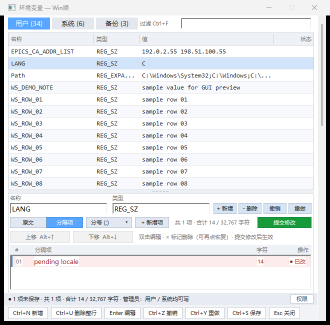
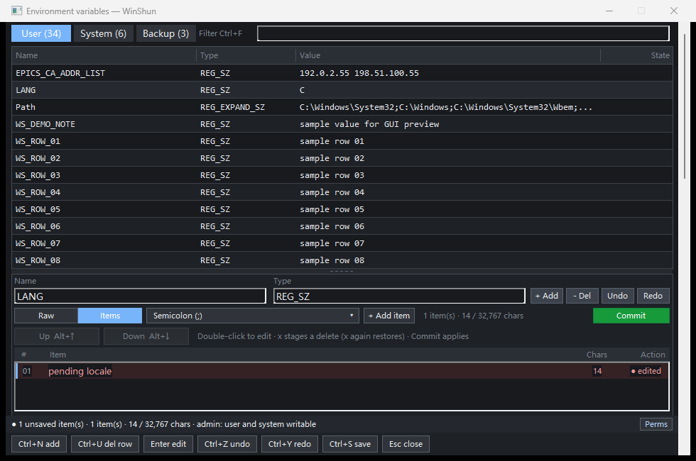

# envhosts 原生编辑器交互修复验证

[English](README.en.md)

## 问题是什么

用户在 0.7.3 原生编辑器中报告五项问题：分隔项上下移按钮不见、底部按钮截字、
Vim 方向相反且缺 dd/gg/G、切回用户变量时备份数量偶发归零，以及切换变量或标签
会接受尚未提交的候选操作。环境为 Windows x64、96 DPI，MinGW Release 构建。
对应设计为插件仓库的 `NATIVE_INTERACTION_FIXES.md`；源文件哈希见 `results.json`。

## 为什么

- `applyLayout` 清空上下移矩形，点击分发也没有对应操作。
- 底部按钮采用固定窄宽度和 16 px 高度，未按实际文字测量。
- 分隔列表 J/K 增量写反，子类未转发 dd/gg/G，原生字符选项还可能覆盖光标移动。
- 备份计数依赖筛选后的页面数组，未在启动时初始化；用户/系统排除条件写反。
- 分隔项改动即时写进工作模型；重建详情又清除待提交标记。切换视图因此看似提交。

## 改了什么

恢复上移/下移按钮并显示 Alt+↑/↓，布局和命中测试共用矩形。底部按实际字体测量，
为删除/恢复/删除整行文案预留宽度，窄窗可换行，并在布局其他面板前保留底部空间。

统一 j/Ctrl+J 向下、k/Ctrl+K 向上，Alt+J/K 下移/上移条目。补齐分隔列表 dd、gg、G，
正确处理命令后的焦点与原生 WM_CHAR；文本框内仍可正常输入字母。

备份总数与范围列表分开维护，在编辑器打开及保存/删除后刷新；修正范围筛选。
分隔项新增、编辑、删除、重排保存在各变量自己的候选缓冲；切换不提交。提交按钮
应用当前变量，形成一次模型撤销；Save 收集所有变量并经过原有写入确认。候选有独立
撤销/重做，草稿保留候选和标记；仅含候选的草稿也询问恢复，恢复后可撤销和重做。

## 实测

| 层级 / 检查 | 预期 | 实际 / 证据 |
|---|---|---|
| L0 打包 | 清单、文件、限制及解包后的程序正确 | 0 failures；包内 exe 与构建哈希一致，`package.txt`、`results.json` |
| L1 CTest | 逻辑、模型、弹窗布局通过 | 3/3，`ctest.txt` |
| L2 协议 | 隔离注册表/hosts、权限和语言切换通过 | 源目录及解包程序均 37/37，`results.json`、`package.txt` |
| L3 真实宿主 | 查询并 Enter 打开当前原生编辑器 | 筛选词回读匹配、exe 哈希匹配、宿主退出 0，`host-smoke.json` |
| L4 原有 GUI | 保存、备份、冲突、hosts、键盘无回归 | 145/145，`gui_regression.txt` |
| L4 五项交互 | 按钮/方向/备份总数/候选/草稿/明确保存正确 | 51/51，`interaction.txt` |
| L4 分隔项状态 | 导航、撤销、混选、新增与分隔符保持一致 | 19/19，`split_state.txt` |
| L4 恢复弹窗 | 正文和按钮完整、恢复/丢弃正确 | 中文浅色及英文深色各 8/8，`dialog_zh.txt`、`dialog_en_dark.txt` |

原有 GUI 的 145 项运行早于最后的候选草稿恢复和最大文案宽度修正；最后变更由
51 项交互专项、双语弹窗和最终 CTest 覆盖。宿主探针前两次误用 GetWindowTextW
读取其他进程的 EDIT 文本而失败，修正为 WM_GETTEXT 后回读成功；未据此修改产品。




复现入口（插件目录）：

```powershell
cmake --build build --config Release
ctest --test-dir build -C Release --output-on-failure
python tests/integration.py
python tests/gui_preview.py --interaction-check --no-hold
python tests/gui_preview.py --split-state-check --no-hold
python tests/gui_preview.py --dialog-check --no-hold
python tests/gui_preview.py --dialog-check --english --dark --no-hold
```

真实宿主使用 `WinShun/build/debug/WinShun.exe --probe-runtime <output>
--runtime-plugins <fixtures> --settle-ms 1500 --live`；`cmd.txt` 发送
`show env WS_ENVHOSTS_INTERACTION_NO_MATCH_20261108` 和 `windows`，对返回的启动器
HWND 发送 Enter，回读编辑器筛选框，再写入 `stop` 等待宿主正常退出。

本地测试包为插件仓库 `dist/interaction-fixes-20261108/ra9fael.envhosts-0.7.3.wsplugin`，
仍沿用 0.7.3 清单，包含本轮未提交修复，不是新的发行版；包内源码包含新测试和设计。
SHA256 为 `1758446c0f417f741f09f63bd9e9cab0393ab8b2d04cf936e3448a65f21887af`。

GUI/协议测试均使用唯一测试键和临时 hosts，脚本已清理这些数据和自身子进程。
未替换用户安装，未改真实环境变量或 hosts。宿主进程已正常退出；自动审批以
“blocked by policy”拒绝清理三个本轮临时配置，未重试。保留路径位于
`C:/Users/renfei/AppData/Local/Temp/` 下的 `WinShun-preview-c58a5629`、
`WinShun-preview-0dbfaecd`、`WinShun-preview-ab25c52c`。
诊断日志、截图原件及宿主 fixture 位于插件 `build/interaction-20261108/`；精选证据
目录小于 0.2 MB。未触碰其他任务的验证目录。本轮插件改动及本验证目录尚未提交。

## 没测的

- 未执行物理显示器间 DPI 切换、屏幕阅读器或真实键盘设备人工验收；GUI 自动化
  操作真实窗口，包含普通 WM_KEYDOWN/WM_CHAR 和现有修饰键测试入口。
- 未对真实 HKLM 或 System32 hosts 进行提权写入；写入与恢复只使用隔离测试数据。
- 未运行 GitHub CI、推送、创建新标签或公开 Release；插件仓库没有 remote。
- 宿主退出仍出现 components 文件监视器 Access denied 警告，但退出码为 0；
  本轮没有修改宿主的文件监视器。

[English](README.en.md)
