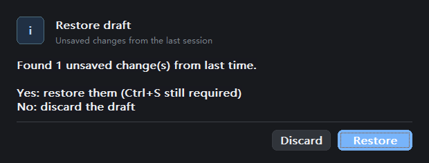

# envhosts native editor continuation

[简体中文](README.md)

## Problem

On November 8, 2026, baseline `eb35144` (0.7.2), the user requested continued
native-editor work and reported clipped Restore draft buttons. A synthetic
fixture reproduced a 196 px window with buttons at y=188..218, clipping 22 px.
Pending split-item deletion also corrupted undo, row changes and delimiter
changes. Adding an item left its editor hidden; reordering lost new-item state,
and mixed new/existing deletion committed existing deletions prematurely.

## Cause

The dialog measured a fixed 40 px body before creating controls. Its second
measurement resized the window only when a detail block existed. Restore draft
has no detail block. Split-list rebuilding reapplied stale deletion indices to
an already updated model, and row selection wrote stale controls into replaced
or refiltered data. Per-item metadata and edit text also became misaligned.

## Changes

- Measure dialog text with the actual font before creating children and reuse
  that geometry for the window and controls. Use themed body/button backgrounds
  and measured button labels. Fix close handling and per-window state storage.
- Make list rebuilding render-only; reset metadata when loading a new value.
  Preserve staged existing items in mixed batches, move new-item state with its
  item, open the inline editor on add, and synchronize modifier/row-action clicks.
- Use unique scratch registry keys for GUI/RPC runs and clean GUI processes and
  scratch data even on exceptions. Add focused regressions and bilingual docs.

## Measured

Windows x64, MinGW Release, desktop DPI 96. `results.json` records the evidence:

| Layer | Expected | Result |
|---|---|---|
| L1 CTest | Logic, model and dialog geometry pass | 3/3 suites; 168/168 layout checks with 100/150/200% font sizes |
| L2 RPC | Isolated edit/delete/restore, denial and locale behavior | 37/37; another 37/37 against the unpacked test package |
| L3 actual host | Load the built exe and open the editor after a query/Enter | Passed on isolated `WinShun/build/debug/WinShun.exe`; filter readback matches, deployed SHA256 matches, host exits 0; `host-smoke.json`, `host-editor.png` |
| L4 existing GUI | Save/conflicts/backups/hosts/keyboard unchanged | 145 passed, 0 failed |
| L4 split-state | Undo/redo/refocus/row/filter/delimiter/mixed deletion preserve values | 19 passed; `split-state.txt` |
| L4 restore dialog | Complete body/buttons and owner re-enabled after discard | 8 checks each in Chinese light and English dark; corrected height 236 px; `dialog.txt` and before/after images |
| L0 test archive | Archive and unpacked protocol checks | 0 failures |

Commands, from the plugin checkout:

```powershell
cmake --build build --config Release
ctest --test-dir build -C Release --output-on-failure
python tests/integration.py
python tests/gui_preview.py --split-state-check --no-hold
python tests/gui_preview.py --dialog-check --no-hold
python tests/gui_preview.py --dialog-check --english --dark --no-hold
python tests/gui_preview.py --no-hold
```




The development package is retained in the plugin's
`dist/native-editor-fixes-20261108/`, with the 0.7.2 manifest, not a new release.
Existing release assets are preserved. Verification processes exited and GUI
tests cleaned their unique keys/data. Automatic approval rejected the bulk
cleanup command for host profiles, the initial failed run's scratch directory,
and the unpacked test installation as "blocked by policy"; these remain.
Selected evidence is archived. The user's running installation/data was not replaced.

## Not tested

- No actual elevated HKLM/System32 writes. L3 queried/opened the editor;
  write/restore checks used isolated registry keys and temporary hosts files.
- 150/200% checks scale fonts; physical monitor DPI transitions were not run.
  Extremely tall dialogs, screen readers and all multi-monitor positions were
  not verified.
- No GitHub CI run, push, new release or replacement of the running installation.
- The isolated host emitted a components watcher Access denied warning at exit
  but returned 0. Query/window behavior passed; its watcher was not changed.
