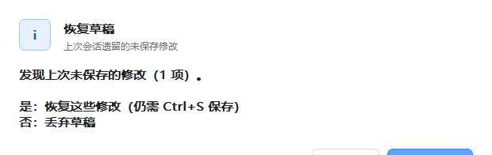
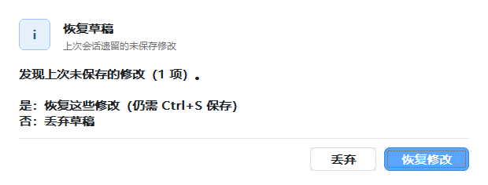
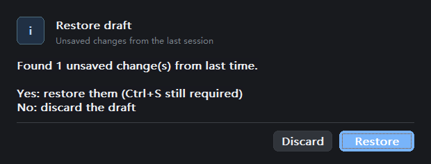

# envhosts 原生编辑器续作验证

[English](README.en.md)

## 问题是什么

2026-11-08，基线 `ra9fael.envhosts` 的 `eb35144`（0.7.2）。用户要求继续完善
原生编辑器，并提供“恢复草稿”弹窗底部按钮被截断的截图。独立假数据复现显示：
窗口高 196 px，两个按钮的范围为 y=188..218，底部 22 px 在窗口外。

检查分隔项编辑时还复现了待删除状态跨撤销、变量切换和分隔符重切造成的误删；
新增项没有打开行内编辑框，新增项移动后状态未同步，混选新增/已有项时提前提交删除。

## 为什么

弹窗首次测量在正文控件创建前用固定 40 px 高度；创建控件后再次测量，只在有
明细区时更新窗口高度。恢复草稿没有明细，因此正文和按钮变高、窗口不变。

分隔项列表重建时再次执行旧下标的删除，而模型已在标记删除时更新。撤销/过滤后
`selectRow` 还把旧控件内容写回新模型，导致重复删除或覆盖另一变量。新增状态、
多选状态和编辑框内容也没有在插入、移动和选择变更时一致更新。

## 改了什么

- 弹窗在创建子控件前按真实字体测量，窗口与控件共用结果；正文及按钮圆角
  使用主题背景，英文按钮按文本宽度布局。窗口关闭和线程内状态管理一并修正。
- 列表重建仅渲染数据，加载新值时清理旧逐项标记；选择变化不写回旧控件。
  混选删除保留已有项为待删除；移动同步新增状态；新增直接打开行内编辑框。
  Ctrl/Shift 选择及单行 × 先结束原编辑，再针对正确条目操作。
- GUI 与协议测试使用唯一临时注册表键；GUI 正常/异常退出清理本次进程与数据。
- 新增分隔项状态、恢复草稿真实窗口测试和 CTest 弹窗布局测试；更新中英文说明。

## 实测

环境：Windows x64、MinGW Release 构建；本机桌面 DPI 为 96。

| 层级 / 测试 | 预期 | 实际 / 证据 |
|---|---|---|
| L1 CTest | 逻辑、模型、弹窗布局全部通过 | 3/3；其中布局 168/168，含 100/150/200% 字体尺寸，见 `results.json` |
| L2 协议集成 | 假注册表和 hosts 读写、权限拒绝、语言切换通过 | 37/37；测试包解压后再测也是 37/37 |
| L3 真实宿主 | 宿主启动当前 exe，查询后 Enter 打开编辑器 | 独立配置的 WinShun `build/debug/WinShun.exe` 成功打开窗口，滤词回读匹配；部署 exe 与构建 SHA256 相同，宿主正常退出 0。见 `host-smoke.json`、`host-editor.png` |
| L4 原有 GUI | 保存、冲突、备份、hosts 和键盘操作无回归 | 145 项通过，0 失败 |
| L4 分隔项专项 | 撤销/重做、重开、切换、混选删除保真 | 19 项通过；见 `split-state.txt` |
| L4 弹窗专项 | 正文、两按钮完整在窗口内，丢弃后恢复编辑器 | 中文浅色、英文深色各 8 项通过。修复后窗口高 236 px，按钮完整可见；见 `dialog.txt` 和 before/after 图片 |
| L0 测试包 | 包结构和解压后协议检查通过 | 0 failures，见 `results.json` |

复现命令（插件目录，Python 3.10+）：

```powershell
cmake --build build --config Release
ctest --test-dir build -C Release --output-on-failure
python tests/integration.py
python tests/gui_preview.py --split-state-check --no-hold
python tests/gui_preview.py --dialog-check --no-hold
python tests/gui_preview.py --dialog-check --english --dark --no-hold
python tests/gui_preview.py --no-hold
```





开发测试包保留在插件的 `dist/native-editor-fixes-20261108/`，沿用 0.7.2 清单，
不是新发布版本；已有发行包未覆盖。验证进程已退出；GUI 每次运行创建的数据和
唯一测试键由测试脚本清理。批量清理宿主临时配置、旧失败用例临时目录及测试解压
目录的命令被自动审批以“blocked by policy”拒绝，因此这些目录仍保留；精选日志和
合成截图已归档。用户当前运行的插件及其正式数据未替换。

## 没测的

- 没有在管理员宿主中做真实 HKLM/System32 hosts 写入；L3 只读查询与打开窗口，
  写入/恢复使用独立测试键和临时 hosts。
- 150%/200% 覆盖字体测量，不代表做过物理显示器间 DPI 切换；超出屏幕高度的
  极端长弹窗、屏幕阅读器和所有多显示器位置组合未验证。
- 本轮没运行 GitHub CI、没推送或创建新 Release、没替换用户正在运行的安装。
- 宿主独立探针退出时出现 components 文件监视器 Access denied 警告，退出码为 0；
  查询及窗口打开已实测通过，本轮未修改宿主文件监视器。
