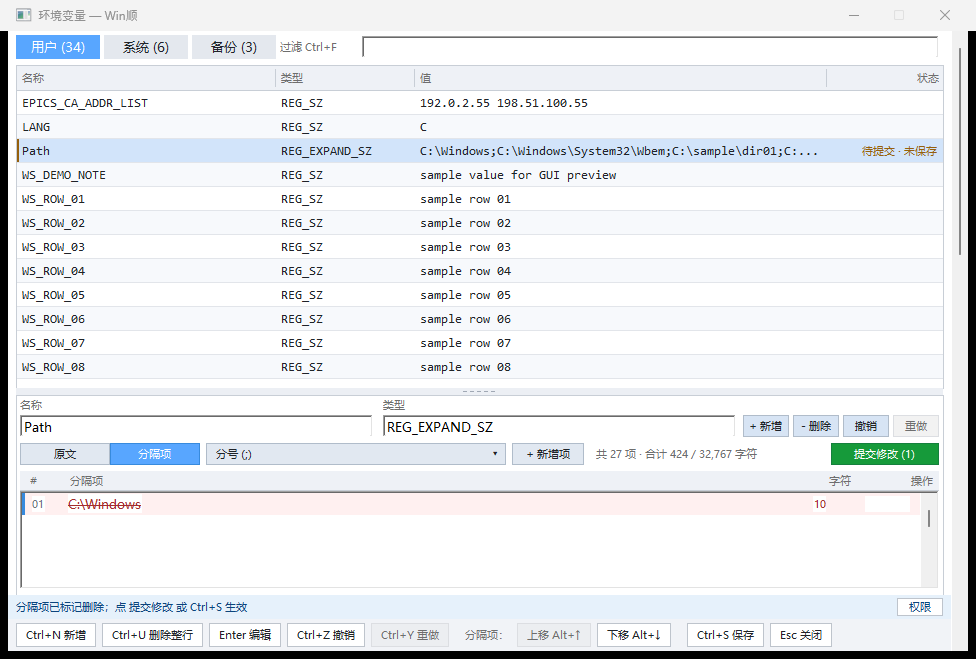
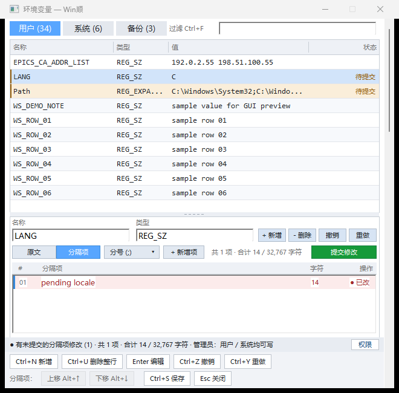
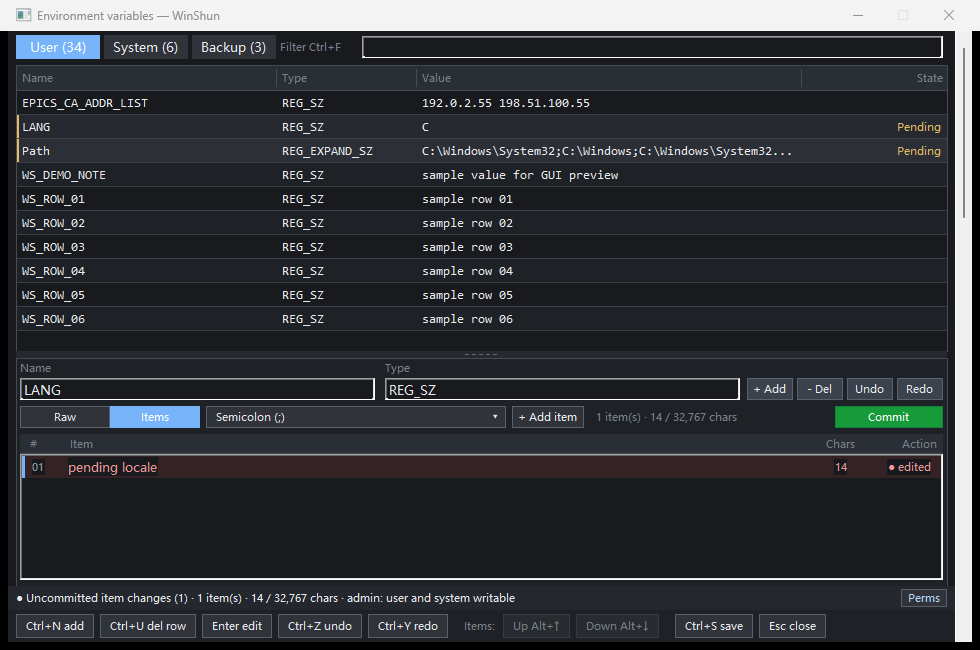

# envhosts v0.7.4 local tagged test package validation

[简体中文](README.md)

## Problem

The user reported missing movement buttons, clipped footer text, reversed/missing
Vim commands, unstable backup counts and navigation accepting candidates. After
the initial fixes, the user approved variable-row candidate status and moving
Up/Down to the footer, followed by commits, a new tag and a test archive.

Environment: Windows x64, 96 DPI, MinGW static Release. See the plugin's
`NATIVE_INTERACTION_FIXES.en.md`. This is a local v0.7.4 tagged test build;
there is no public release or online registry update.

## Cause

Row rendering queried only model `rowState()`, omitting per-variable candidate
sessions. Candidates correctly stayed outside the model, so their rows looked
unchanged. Up/Down occupied a dedicated detail row, reducing list space. Root
causes of the earlier five issues are in the plugin's
`NATIVE_INTERACTION_FIXES.en.md`, under “Grounded facts”.

## Changes

Combine candidate/model status by scope and variable name: Pending, Unsaved or
both, retaining New/Deleted meanings. Add/edit/delete/reorder, navigation,
undo/redo, Commit, Save and draft recovery update the indicator. Selected rows
retain their label and side marker. Measure the longest locale labels. The
table still shows the model value; candidates remain in the detail preview.
Status rendering does not commit them.

The footer Items group contains Up Alt+Up and Down Alt+Down. Boundary, empty
and non-editable states disable the appropriate action. Clicks preserve item
selection and restore list focus. Groups wrap with height reserved before pane
layout. Removing the old toolbar moves the list start up by 28 px. Commit stays
near the candidate preview. This version also includes all five earlier fixes.

## Measured results

| Layer / check | Expected | Actual / evidence |
|---|---|---|
| L0 archive/source | Tag, version, commit and source agree | 83 files; 82 source files verified against commit blobs; exe matches clean build; 0 registry errors; `results.json` |
| L1 clean CTest | Logic, model and dialog layout pass | 3/3; `ctest.txt` |
| L2 protocol | Isolated env/hosts, permissions and locale pass | 37/37 from checkout and extracted archive; `package.txt`, `results.json` |
| L3 real WinShun | Query/Enter opens matching exe with correct filter | Exact filter readback and exe hash; host exit 0; `host-smoke.json` |
| L4 existing GUI | Save, backup, conflicts, hosts and keyboard remain correct | 145/145; `gui.txt` |
| L4 focused / packaged focused | Candidates, status, keys, layout, recovery and Save | Both 94/94; `focused.txt`, `package_focused.txt` |
| L4 split state | Mixed/new/deleted items, delimiter and undo remain consistent | 19/19; `split_state.txt` |

Checks include combined status, new/deleted variables, equal Path names across
scopes, recovered markers, clearing after Save and measured Chinese/English
layouts at 660/980 px. Synthetic screenshots were visually inspected:





Release commit: `8802c282f468da020260ab7bb72346e23fc421c6`, pointed to by annotated
tag v0.7.4. Implementation commit: `dc421ac`. Build came from a clean local clone,
without copying the working-directory exe. The final archive was extracted and
its executable passed protocol and focused GUI checks. The plugin worktree is clean.

Deliverables under the plugin's `dist/release-v0.7.4/`: `.wsplugin`, `.sha256`
and bilingual `release-notes.md`. Previous v0.7.3 assets remain intact.

- Archive: `ra9fael.envhosts-0.7.4.wsplugin`, 6,048,594 bytes.
- SHA256: `052b542696189ea049c078786d6367e28eaaaf7fa021b189d488c03edaf62b3d`.
- Exe SHA256: `26c30b4ff8448198012fc29a0192300f3519de40003ac54a0ea5a9729d3437c3`.

Reproduce from clean plugin source:

```powershell
cmake -B build -G "MinGW Makefiles" -DCMAKE_BUILD_TYPE=Release
cmake --build build --config Release
ctest --test-dir build -C Release --output-on-failure
python tests/integration.py
python tests/gui_preview.py --interaction-check --no-hold
python tests/gui_preview.py --split-state-check --no-hold
python tests/gui_preview.py --no-hold
python tools/package.py --tag v0.7.4 --out dist/release-v0.7.4
```

GUI/protocol tests used unique registry keys and temporary hosts, cleaned by the
harness with its own child processes. The isolated host exited normally. The
user's installation, actual environment and hosts were not changed. Automatic
approval rejected cleanup with “blocked by policy”; no retry was made. Retained
under the plugin's `build/release-v0.7.4/`: `source/`,
`package-check/ra9fael.envhosts/`, `host-c1b8cc94/fixtures/` and
`host-c1b8cc94/temp/`. Logs, original synthetic screenshots and reproduction
scripts remain in the task directory. Selected evidence is under 0.2 MB.
Previously rejected cleanup targets were untouched.

## Not tested

- Physical monitor DPI switching, screen readers or manual physical keyboard
  acceptance. Automation operates real native windows.
- A separate non-elevated host for system read-only variables this turn. Disabled
  actions were tested at boundaries, in empty views and for deleted/non-editable
  rows; the shared `rowEditable` condition was verified in source.
- Actual elevated HKLM/System32 hosts writes; writes used isolated fixtures only.
- GitHub CI, remote tags or public Release. The plugin repository has no remote;
  this delivery is a local tagged test package.
- Host logs still contain foreground-activation and components watcher Access
  denied warnings, with successful query/readback and exit 0. Host activation and
  watcher code were not modified.

[简体中文](README.md)
