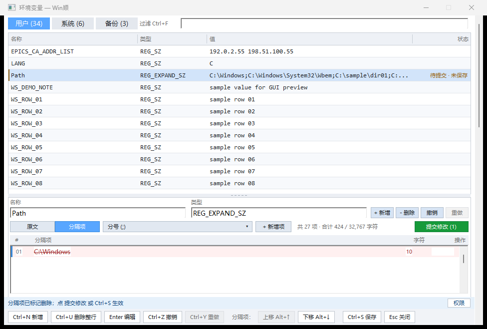
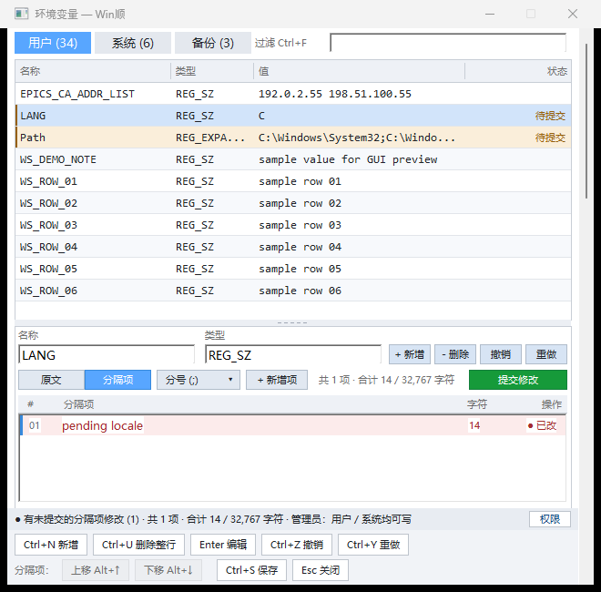
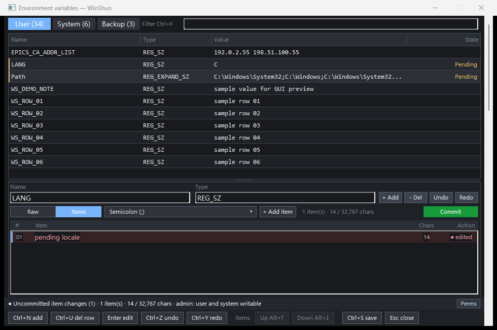

# envhosts v0.7.4 本地标签测试包验证

[English](README.en.md)

## 问题是什么

用户报告原生编辑器缺少上下移按钮、底部截字、Vim 方向相反及缺少命令、备份数量
不稳定、切换视图会接受候选操作。前轮修复后，用户又确认本轮方案：上方 Path 等
变量行必须显示候选状态，上下移并入底部。授权提交、打新标签并生成测试包。

环境：Windows x64、96 DPI、MinGW 静态 Release 构建。插件设计见
`ra9fael.envhosts/NATIVE_INTERACTION_FIXES.md`。本轮交付为本地 `v0.7.4` 标签，
没有公开发布或修改线上索引。

## 为什么

上方状态列只调用模型 `rowState()`，没有读取保存在各变量候选会话中的修改。
候选正确地未进入模型，因此变量行没有显示状态。上下移占用详情中的独立一行，
减少了列表空间。前五项问题的代码依据见插件仓库
`NATIVE_INTERACTION_FIXES.md` 的“代码依据”一节。

## 改了什么

按范围和变量名合并候选/工作模型状态，显示“待提交”“未保存”或两者组合；新增
和整行删除保留对应含义。候选新增、编辑、删除、重排以及导航、撤销/重做、提交、
保存和草稿恢复均更新状态。选中行保留标签和左侧标记。状态列测量中英文最长文案，
上方值列仍显示模型值，候选只在下方预览，状态展示不会隐式提交。

底部加入“分隔项”组，包含上移 Alt+↑、下移 Alt+↓。首尾、空列表和不可编辑行禁用
对应按钮；点击后保持条目选中和列表焦点。底部按组换行，先预留高度再布局其他
区域。移除详情中独占的按钮行，列表起点上移 28 px；提交按钮仍靠近候选预览。
前轮五项修复一并包含在本版本中。

## 实测

| 层级 / 检查 | 预期 | 实际与证据 |
|---|---|---|
| L0 包与源码 | 标签、版本、提交、包内源码一致 | 83 文件；82 个源码逐一与提交 blob 核对；包内 exe 与干净构建一致；索引检查 0 errors，`results.json` |
| L1 干净源码 CTest | 逻辑、模型、弹窗布局通过 | 3/3，`ctest.txt` |
| L2 协议 | 隔离环境变量/hosts 及权限、语言检查通过 | 源目录及解包程序均 37/37，`package.txt`、`results.json` |
| L3 真实 WinShun | 查询后 Enter 打开新程序，筛选参数正确 | 精确筛选词回读、exe SHA256 一致，宿主退出 0；`host-smoke.json` |
| L4 原有 GUI | 保存、备份、冲突、hosts、键盘无回归 | 145/145，`gui.txt` |
| L4 专项 / 包内专项 | 候选、状态、导航、键位、布局、草稿、保存正确 | 源目录和最终包内程序各 94/94，`focused.txt`、`package_focused.txt` |
| L4 分隔项状态 | 混选、新增、删除、分隔符和撤销保持一致 | 19/19，`split_state.txt` |

专项含组合状态、新增变量状态、整行删除状态、两个范围的同名 Path 隔离、草稿
恢复后的标记、保存后清除，以及中英 660/980 px 的测量检查。人工检查合成截图：





发布提交为 `8802c282f468da020260ab7bb72346e23fc421c6`，注释标签 `v0.7.4` 指向
该提交；功能提交为 `dc421ac`。从干净本地克隆配置并构建，未复制工作目录 exe。
最终包解压后再运行协议和专项 GUI。插件工作树干净。

交付文件位于插件仓库 `dist/release-v0.7.4/`，包含 `.wsplugin`、`.sha256` 和双语
`release-notes.md`；此前 v0.7.3 资产保留。

- 包：`ra9fael.envhosts-0.7.4.wsplugin`，6,048,594 bytes。
- SHA256：`052b542696189ea049c078786d6367e28eaaaf7fa021b189d488c03edaf62b3d`。
- 程序 SHA256：`26c30b4ff8448198012fc29a0192300f3519de40003ac54a0ea5a9729d3437c3`。

复现命令（干净插件源码目录）：

```powershell
cmake -B build -G "MinGW Makefiles" -DCMAKE_BUILD_TYPE=Release
cmake --build build --config Release
ctest --test-dir build -C Release --output-on-failure
python tests/integration.py
python tests/gui_preview.py --interaction-check --no-hold
python tests/gui_preview.py --split-state-check --no-hold
python tests/gui_preview.py --no-hold
python tools/package.py --tag v0.7.4 --out dist/release-v0.7.4
```

GUI/协议测试用唯一测试键与临时 hosts，脚本已清理其数据与子进程。宿主使用独立
配置并正常退出；未替换用户安装，未改真实环境变量或 hosts。自动审批以
“blocked by policy”拒绝清理本轮构建副本、测试解包和宿主临时目录，未重试：保留
插件 `build/release-v0.7.4/` 下的 `source/`、`package-check/ra9fael.envhosts/`、
`host-c1b8cc94/fixtures/`、`host-c1b8cc94/temp/`。日志、合成截图原件和复现脚本
也保留在任务目录；精选证据小于 0.2 MB。此前被拒绝的目录未动。

## 没测的

- 物理显示器 DPI 切换、屏幕阅读器及真实键盘设备人工验收；自动化操作真实窗口。
- 非管理员宿主的系统变量只读场景本轮未单独启动验证；禁用行为实测覆盖首尾、
  空列表及整行删除造成的不可编辑状态，共用 `rowEditable` 条件由代码确认。
- 真正的 HKLM/System32 hosts 提权写入；写入只针对隔离 fixture。
- GitHub CI、远程标签和公开 Release；插件仓库没有 remote。本轮仅本地标签测试包。
- 宿主日志仍含前台激活与 components 监视器 Access denied 警告，但查询、窗口
  回读均成功，退出码为 0。本轮未修改宿主窗口激活或文件监视器。

[English](README.en.md)
